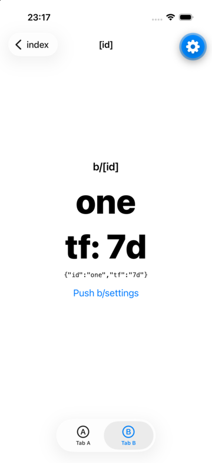
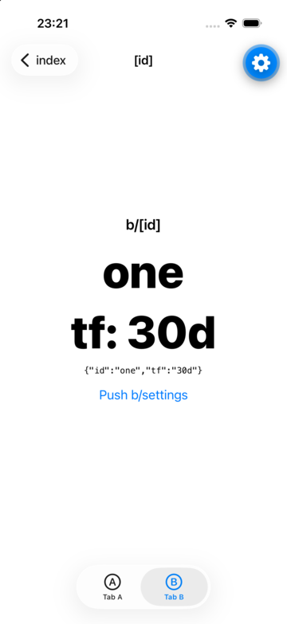
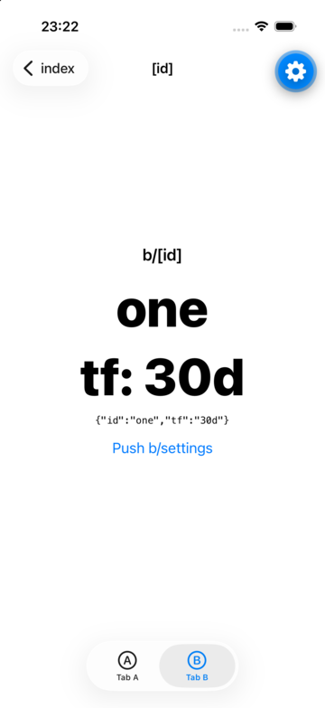

# expo-router: a reused stack screen gets its first-mount params back

Minimal repro for [expo/expo#51385](https://github.com/expo/expo/issues/51385). Fix PR: [expo/expo#51759](https://github.com/expo/expo/pull/51759).

Navigate to a stack screen that is already mounted, with new params. The screen shows the new params, then the params from its first mount come back.

| Trigger 1, before | Trigger 2, before | Trigger 1, with fix | Trigger 2, with fix |
|---|---|---|---|
|  |  |  |  |

## Versions

- expo 58.0.21 (`create-expo-app@latest`, blank-typescript template; `npx expo install --fix` moved react-native from 0.88.1 to 0.88.0 so `npx expo-doctor` passes)
- expo-router 58.0.28 (latest on npm on 2026-10-28)
- react-native 0.88.0, react 19.3.0, react-native-screens 4.30.1
- Expo Go 58.0.7 on an iPhone 17 Pro simulator, iOS 26.5 (Xcode 27.1)

The app has no dependencies beyond the template and expo-router's own peers. `.npmrc` sets `legacy-peer-deps=true`. Without it, `npm ci` fails on a react-dom peer conflict that comes from the template and expo-router's web dependencies, not from this repro.

## App

- `app/_layout.tsx`: `NativeTabs` with tabs `a` and `b`. It logs each incoming deep link and each params change of every `b/[id]` route, with the route key.
- `app/a`, `app/b`: a `Stack` per tab.
- `app/b/[id].tsx`: shows `id` and the `tf` search param in large text.
- `app/b/settings.tsx`: a second screen to push on top of `b/[id]`.

Every button opens a real deep link with `Linking.openURL(Linking.createURL(path))`.

## Run

```sh
npm ci
npx expo start --ios
```

Restart the app (kill Expo Go and reopen the project) before each trigger.

### Trigger 1: from another tab (the case in #51385)

1. Tab B: tap **Deep link /b/one?tf=7d**. The screen shows `one` and `tf: 7d`.
2. Switch to tab A.
3. Tap **Deep link /b/one?tf=30d**.

### Trigger 2: in the same tab

1. Tab B: tap **Deep link /b/one?tf=7d**.
2. Tap **Push b/settings**. The stack is `[index, [id], settings]`.
3. Tap **Deep link /b/one?tf=30d**.

**Expected:** `b/[id]` shows `tf: 30d`.

**Actual:** `b/[id]` shows `tf: 7d`.

Without tapping, the same steps run with `xcrun simctl openurl` (Expo Go URL, default port 8081):

```sh
open_link() { xcrun simctl openurl booted "exp://127.0.0.1:8081/--$1"; sleep 4; }
# Trigger 1
open_link '/b/one?tf=7d'; open_link '/a'; open_link '/b/one?tf=30d'
# Trigger 2 (after an app restart)
open_link '/b/one?tf=7d'; open_link '/b/settings'; open_link '/b/one?tf=30d'
```

I ran both triggers this way 3 times each, each time after a cold start. Both reproduced 3 of 3. The Metro log shows two updates on the same route key:

```
# Trigger 1
[state] [id] routes: [id]:0-1-1 {"id":"one","tf":"30d","__internal_expo_router_no_animation":true}
[state] [id] routes: [id]:0-1-1 {"id":"one","tf":"7d"}
# Trigger 2
[state] [id] routes: [id]:0-1-1 {"id":"one","tf":"30d"}
[state] [id] routes: [id]:0-1-1 {"id":"one","tf":"7d"}
```

In trigger 2 the new params do not carry `__internal_expo_router_no_animation`, and the old params still come back. The listener checks the flag on the `route` it captured at first mount. That route had the flag, because the first visit came from a deep link. So from then on, every `transitionEnd` on this screen writes the first-mount params back.

## Cause

In `build/useScreens.js`, `BaseRoute` adds a `transitionEnd` listener in a `useEffect` with deps `[navigation]`. The listener calls `replaceParams(removeParams(route?.params, [INTERNAL_EXPO_ROUTER_NO_ANIMATION_PARAM_NAME]))` with the `route` from the first render.

## Fix

The `fix-patch` branch adds one line with patch-package ([`patches/expo-router+58.0.28.patch`](https://github.com/hognevevle/expo-router-stale-params-repro/blob/fix-patch/patches/expo-router%2B58.0.28.patch)):

```diff
         }, [
-            navigation
+            navigation,
+            route
         ]);
```

```sh
git checkout fix-patch
npm ci   # postinstall runs patch-package
npx expo start --ios -c
```

With the patch, both triggers end on `tf: 30d`, 3 of 3 each. PR #51759 fixes the same listener with `React.useEffectEvent`.

## Note on expo-router 58 vs 57

On expo-router 57.x (seen on 57.0.17), a deep link to `b/[id]` with a different `id` also reuses the mounted route, so `id` itself reverts, as described in #51385. On 58.0.28, `resolveNavigationDestination` only pops to a dynamic route whose `id` matches. A different `id` pushes a new screen there. This repro therefore keeps `id` the same and changes the `tf` search param. The listener code is the same in both versions.
